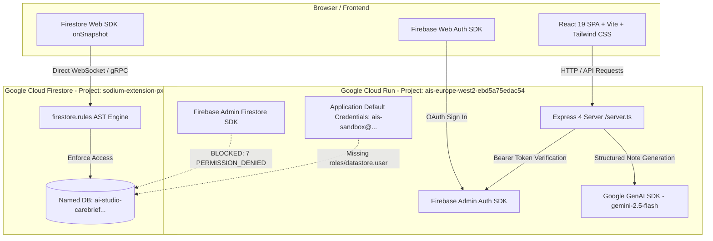
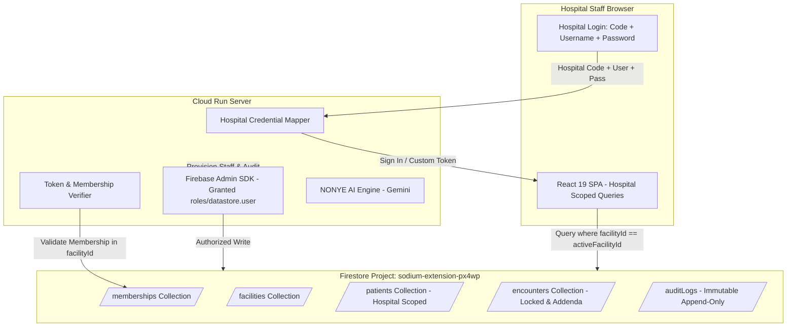

# CornerBrief — Technical Requirements Document (TRD)

**Document Identifier:** CB-TRD-V1.0  
**Project Name:** CornerBrief  
**Embedded AI Assistant:** NONYE AI  
**Author / Lead:** Mervyn Dean Hilary (`mervyndeanhilary@gmail.com`)  
**Development Platform:** Google AI Studio Build  
**Document Status:** Baseline Generated from Existing Codebase Audit  
**Date:** October 2026  

---

## 1. Technical Overview

CornerBrief is implemented as a full-stack web application hosted on Google Cloud Run:
* **Frontend:** Single Page Application (SPA) built with React 19, TypeScript, Vite, Tailwind CSS v4, and Motion.
* **Backend:** Node.js Express 4 server (`server.ts`) running on port 3000, serving API endpoints and mounting Vite middlewares in development.
* **Database & Persistence:** Google Cloud Firestore (dedicated named database `ai-studio-carebrief-3a5f4224-3c34-41c4-ba6c-41b73bdfc6dc` in project `sodium-extension-px4wp`).
* **Authentication:** Firebase Authentication (Client Web SDK for Google OAuth popups; Firebase Admin SDK for server-side token verification and account creation).
* **AI Engine:** Google Gemini (`gemini-2.5-flash`) via the `@google/genai` TypeScript SDK with strict JSON schema parsing and a deterministic clinical organizer fallback.

---

## 2. Current Architecture Diagram



---

## 3. Frontend Architecture and Major Components

* **Framework:** React 19.0.1 running on Vite 8.3.0.
* **Styling Engine:** Tailwind CSS v4 (`@tailwindcss/vite` and `@import "tailwindcss";` in `src/index.css`).
* **Component Directory (`src/components/`):**
  * `LoginScreen.tsx`: Authentication screen, hospital selection, Google popup trigger, demo preview.
  * `DashboardView.tsx`: Real-time operational census, consultation metrics, recent encounter feed.
  * `PatientsView.tsx` & `PatientModal.tsx`: Searchable patient list, status filters, registration form.
  * `PatientProfileView.tsx`: Chronological encounter timeline, patient header, vitals history.
  * `NewEncounterView.tsx`: Point-of-care intake (BP, Pulse, Temp, SpO2, PCV, Glucose, narrative note).
  * `AiDocumentationView.tsx`: NONYE AI note diffing/review workspace, finalization lock, signed addenda.
  * `EncountersView.tsx`: Filterable facility encounter archive.
  * `ReportsView.tsx`: Departmental consultation metrics, review velocity charts, audit event feed.
  * `SettingsView.tsx`: Facility profile, department management, staff account provisioning modal.
  * `PlatformAdminView.tsx`: Multi-hospital registry, facility status toggle, platform audit trail.
  * `FacilityOnboardingModal.tsx`: 4-step guided registration wizard for healthcare facilities.

---

## 4. Backend Architecture and API Responsibilities

The backend server is implemented in `server.ts` and runs as an Express application on port 3000:

| Endpoint | Method | Authentication | Core Responsibility |
| :--- | :---: | :---: | :--- |
| `/api/ai/generate-documentation` | `POST` | Bearer Firebase ID Token | Verifies caller token, validates patient/encounter ownership, invokes Gemini 2.5 Flash, validates JSON output against strict clinical schema. |
| `/api/admin/verify-caller` | `GET` | Bearer Firebase ID Token | Decodes caller token, evaluates bootstrap admin standing, queries `/admins/{uid}` and hospital ownership, returns authorized role claims. |
| `/api/admin/provision-staff` | `POST` | Bearer Firebase ID Token | Verifies caller is Platform or Facility Admin, enforces role hierarchy, creates Auth user with temp password, persists profile via Admin SDK, writes audit log, executes rollback on failure. |

---

## 5. Authentication and Authorization Architecture

* **Client Authentication:** Evaluated in `src/App.tsx` via `onAuthStateChanged(auth, async (user) => ...)`.
* **Server Token Cryptography:** `adminAuth.verifyIdToken(idToken)` cryptographically checks token signatures, audience, issuer, and expiration.
* **Authority Verification Helper (`verifyAdministratorCaller`):**
  1. Compares caller email against platform bootstrap administrator (`mervyndeanhilary@gmail.com`).
  2. Checks for record existence in `/admins/{callerUid}`.
  3. Queries caller profile in `/users/{callerUid}` and facility ownership in `/facilities/{facilityId}`.
* **Client Role Hydration Defense:** `initializeFirestoreWorkspace` independently calls `/api/admin/verify-caller`. If a profile claims `PlatformAdmin`, `FacilityAdmin`, or `Admin` without server verification, the active session is demoted to `'Clinician'`.

---

## 6. Firestore Database Structure and Data Ownership

The data model is formalized in `firebase-blueprint.json`:

| Collection Path | Entity Type | Ownership / Tenant Model | Invariants & Schemas |
| :--- | :--- | :--- | :--- |
| `/facilities/{facilityId}` | `Facility` | `ownerId == request.auth.uid` | Name, location, facilityCode, status (`Active`, `Onboarding`, `Suspended`), departments. |
| `/users/{userId}` | `UserProfile` | `id == userId && ownerId == userId` | Name, email, role, facilityId, department, createdAt. |
| `/patients/{patientId}` | `Patient` | `ownerId == request.auth.uid` | Internal MRN code, name, DOB, sex, contact info, status, assigned doctor/nurse IDs. |
| `/encounters/{encounterId}` | `Encounter` | `ownerId == request.auth.uid` | Vitals, narrative note, AI structured output, reviewed note, status, addenda array. |
| `/auditLogs/{logId}` | `AuditLog` | `ownerId == request.auth.uid` | Immutable append-only log: user, role, action description, timestamp. |
| `/admins/{adminId}` | Admin Metadata | Bootstrap Admin only | List of platform administrator UIDs authorized for cross-facility management. |

---

## 7. Facility Tenancy and Patient Assignment Model

### Current Reality: Single-User Creator Isolation
* Every clinical entity enforces `ownerId == request.auth.uid`.
* Facilities, patients, and encounters are siloed to the user who registered them.
* Hospital-level data sharing does not currently exist at the database layer: doctors cannot view patients created by hospital intake staff or administrators.

### Assignment Model Status
* `assignedDoctorUid`, `assignedNurseUid`, and `assignedStaffUids` exist in `src/types.ts` and `isValidPatient` validation in `firestore.rules`.
* **Current Enforcement:** None. They are unenforced placeholder fields in the data schema.

---

## 8. NONYE AI and Gemini Integration

* **SDK Version:** `@google/genai` TypeScript SDK (v2.4.0).
* **Model Alias:** `gemini-2.5-flash`.
* **User-Agent Tracking:** Configured with required header `'User-Agent': 'aistudio-build'` in `server.ts`.
* **Output Validation:** All model outputs pass through `validateAiDocumentationSchema()`, ensuring:
  * String fields: `encounterSummary`, `presentingConcern`.
  * String arrays: `relevantHistory`, `medications`, `allergies`, `investigations`, `clinicalNotes`, `followUpItems`, `missingInformation`.
  * Mandatory flag: `requiresReview: true`.
* **Deterministic Fallback:** If `GEMINI_API_KEY` is missing or set to placeholder value, `buildDeterministicDocumentation()` organizes clinical facts using an in-memory rule engine without failing the consultation.

---

## 9. Security Rules and Server-Side Validation

### Firestore Rules Architecture (`/firestore.rules`)
```javascript
rules_version = '2';
service cloud.firestore {
  match /databases/{database}/documents {
    match /{document=**} { allow read, write: if false; }
    
    // Primitives
    function isSignedIn() { return request.auth != null && request.auth.token.email_verified == true; }
    function isBootstrappedAdmin() { return isSignedIn() && request.auth.token.email == 'mervyndeanhilary@gmail.com'; }
    function isAdmin() { return isBootstrappedAdmin() || exists(/databases/$(database)/documents/admins/$(request.auth.uid)); }
    
    // Immutable Audit Trail
    match /auditLogs/{logId} {
      allow get, list: if isSignedIn() && (existing().ownerId == request.auth.uid || isAdmin());
      allow create: if isSignedIn() && incoming().ownerId == request.auth.uid && isValidAuditLog(incoming());
      allow update, delete: if false;
    }
    
    // Locked Finalized Encounters
    match /encounters/{encounterId} {
      allow create: if isSignedIn() && isValidEncounter(incoming());
      allow update: if isSignedIn() && (existing().ownerId == request.auth.uid || isAdmin()) &&
        (existing().status != 'Finalized' || (incoming().status == 'Finalized' && incoming().originalInput == existing().originalInput));
    }
  }
}
```

---

## 10. Staff Provisioning and Account Lifecycle

* **Endpoint:** `POST /api/admin/provision-staff` in `server.ts`.
* **Role Hierarchy Enforcement:** Facility Admins can only provision `['Doctor', 'Nurse', 'Clinician', 'RecordsStaff', 'HR', 'Staff']`. Provisioning `PlatformAdmin` is hard-rejected.
* **Credential Generation:** Creates an Email/Password account via `adminAuth.createUser()`.
* **Persistence Mechanism:** Writes to `users/{newUid}` via `adminDb` (Admin SDK).
* **Fail-Closed Rollback (`rollbackStaffProvisioning`):**
  If `adminDb` profile write or audit log write fails:
  1. Deletes the newly written user document (if persisted).
  2. Deletes the newly created Firebase Auth account via `adminAuth.deleteUser(newUid)`.
  3. Returns HTTP 502 with no credentials disclosed.

---

## 11. Audit Logging and Record Immutability

* **Collection:** `/auditLogs/{logId}`.
* **Immutability Guarantee:** Enforced in `firestore.rules` via `allow update, delete: if false;`.
* **Logged Events:** Staff provisioning, patient registration, encounter creation, NONYE AI note structuring, clinical note finalization, and addenda signing.

---

## 12. Google Cloud Run Deployment Architecture

* **Container Runtime:** Google Cloud Run managed container running Node.js / Express.
* **Hosting Project ID:** `ais-europe-west2-ebd5a75edac54` (Numeric Project Number: `900563531568`).
* **Region / Zone:** `europe-west2` (`projects/900563531568/zones/europe-west2-1`).
* **Active Cloud Run Service:** `ais-dev-2lmibzlcblr4gj4hfdoxra` (Revision: `ais-dev-2lmibzlcblr4gj4hfdoxra-00002-n77`).
* **Runtime Service Account:** `ais-sandbox@ais-europe-west2-ebd5a75edac54.iam.gserviceaccount.com` (Unique ID: `117367076711668642210`).

---

## 13. Google Cloud and Firestore Project Relationships

CornerBrief operates across a **cross-project topology**:
* **Application Host Project:** `ais-europe-west2-ebd5a75edac54` (Hosting Cloud Run compute).
* **Database & Auth Project:** `sodium-extension-px4wp` (Project Number: `758062022045`).
* **Named Firestore Database:** `ai-studio-carebrief-3a5f4224-3c34-41c4-ba6c-41b73bdfc6dc`.

---

## 14. Known Infrastructure and IAM Failures

* **Observed Error:** When `server.ts` executes `adminDb.collection('users').doc(newUid).set()`, the gRPC client throws:
  `7 PERMISSION_DENIED: Missing or insufficient permissions.`
* **REST Probe Evidence:** Direct GET/POST probe to `https://firestore.googleapis.com/v1/projects/sodium-extension-px4wp/databases/ai-studio-carebrief.../documents/users` using the server's ADC OAuth access token returns:
  `HTTP 403 Forbidden` (`{"error": {"code": 403, "message": "Missing or insufficient permissions.", "status": "PERMISSION_DENIED"}}`).
* **Root Cause:** The Cloud Run service account `ais-sandbox@ais-europe-west2-ebd5a75edac54.iam.gserviceaccount.com` lacks the Google Cloud IAM role `roles/datastore.user` on project `sodium-extension-px4wp`.
* **Current Behavior:** The server fails closed, deletes the temporary auth account, and returns HTTP 502.

---

## 15. Testing Approach and Evidence

* **Live API Execution (Passed):** Unauthenticated calls to all endpoints return HTTP 401; forged token calls return HTTP 401.
* **Compiler & Static Analysis (Passed):** `npm run lint` (`tsc --noEmit`) passes with 0 errors.
* **Production Build (Passed):** `npm run build` (`vite build`) compiles cleanly in 1.65 seconds.
* **Rules AST Linter (Passed):** `npx eslint firestore.rules` passes with 0 warnings and 0 errors.
* **Database Access (Blocked):** Admin SDK live read query throws `7 PERMISSION_DENIED`.

---

## 16. Security Gaps and Technical Risks

1. **Staff Provisioning Failure:** New staff accounts cannot be created by hospital administrators until GCP IAM is granted.
2. **Account Suspension Gap:** `firestore.rules` does not verify `status != 'Suspended'`; suspended users retain read access to documents they own.
3. **Clinical Role Self-Creation:** Direct client writes to `/users/{uid}` on initial creation allow assigning `Doctor`, `Nurse`, `HR`, and `RecordsStaff`.
4. **Blanket Platform Admin PHI Exposure:** `isAdmin()` has unconditional read access across all patient charts in all hospitals.
5. **Creator-Siloed Data:** `ownerId == request.auth.uid` prevents multi-clinician care within the same hospital.

---

## 17. Recommended Target Architecture



---

## 18. Migration and Compatibility Considerations

* **Phase 1 (IAM First):** Grant GCP IAM without changing code; unblocks staff provisioning immediately.
* **Phase 2 (Non-Breaking Rules):** Add `isActiveStaff()` to `firestore.rules` to enforce suspension.
* **Phase 3 (Memberships):** Create `/memberships` collection alongside existing user records to prevent breaking active sessions.
* **Phase 4 (Query Cutover):** Transition Firestore listeners from `where('ownerId', '==', uid)` to `where('facilityId', '==', activeFacilityId)`.

---

## 19. Deployment Prerequisites and External Permissions Required

To resolve the core blocker, an authorized Google Cloud project administrator on project `sodium-extension-px4wp` must execute:

```bash
gcloud projects add-iam-policy-binding sodium-extension-px4wp \
    --member="serviceAccount:ais-sandbox@ais-europe-west2-ebd5a75edac54.iam.gserviceaccount.com" \
    --role="roles/datastore.user" \
    --condition='expression=resource.name == "projects/sodium-extension-px4wp/databases/ai-studio-carebrief-3a5f4224-3c34-41c4-ba6c-41b73bdfc6dc",title="CornerBrief Named DB Access",description="Grants Datastore User role strictly to CornerBrief database"'
```

---

## 20. Technical Roadmap and Acceptance Tests

| Technical ID | Target Architecture Item | Acceptance Test Protocol |
| :---: | :--- | :--- |
| **TRD-001** | Cross-Project IAM Binding | Invoke `POST /api/admin/provision-staff`; verify HTTP 201; verify profile write in Firestore. |
| **TRD-002** | Suspension Enforcement Rule | Mark test user status `'Suspended'`; attempt `getDoc()`; assert `PERMISSION_DENIED`. |
| **TRD-003** | Clinical Role Self-Creation Lock | Attempt `setDoc` with `role: 'Doctor'`; assert `PERMISSION_DENIED`. |
| **TRD-004** | Hospital Membership Collection | Provision doctor to Hospital A; query `/memberships`; assert membership document created. |
| **TRD-005** | Hospital-Scoped Firestore Rules | Authenticate as Doctor at Hospital A; query patient created by intake at Hospital A; assert read succeeds. |
| **TRD-006** | Platform Admin PHI Segregation | Authenticate as Platform Admin; attempt direct read on `/patients/{id}`; assert `PERMISSION_DENIED`. |
| **TRD-007** | Institutional Login Interface | Enter Hospital Code + Staff Username + Password on login screen; assert session authenticated without Google popups. |
